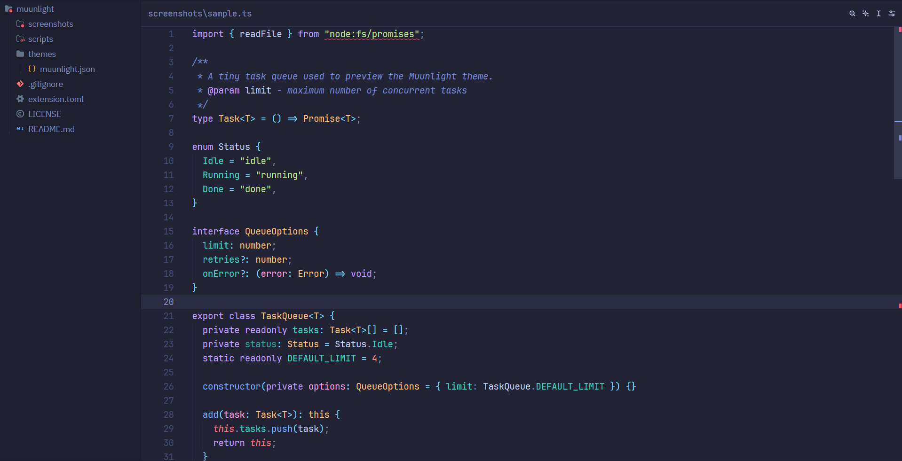
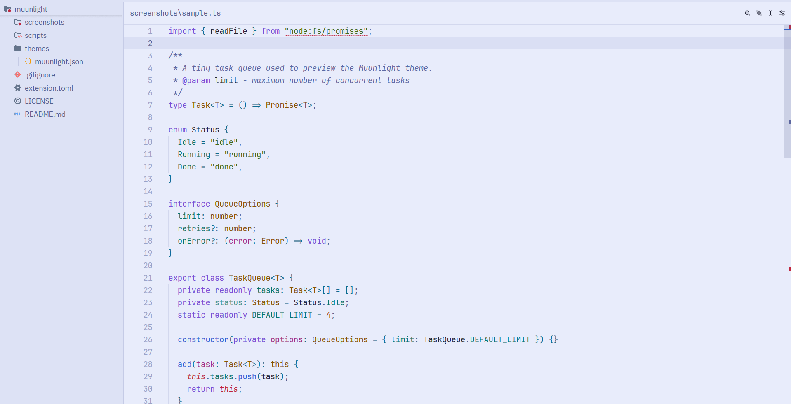

# Muunlight

A [Zed](https://zed.dev) theme inspired by [Moonlight II](https://github.com/atomiks/moonlight-vscode-theme) by atomiks. It includes two variants:

- **Muunlight Dark**: faithful to the Moonlight II palette, with a deep indigo background, soft blues, violets and pastel accents.
- **Muunlight Light**: a light variant derived from the same palette, with accents darkened to keep syntax colors at roughly 4.5:1 contrast.

## Screenshots

### Muunlight Dark



### Muunlight Light



## Installation

### From the Zed extensions page

1. Open the command palette and run `zed: extensions`.
2. Search for **Muunlight** and click **Install**.
3. Run `theme selector: toggle` and pick **Muunlight Dark** or **Muunlight Light**.

### As a dev extension

1. Clone this repository.
2. In Zed, open the command palette and run `zed: install dev extension`.
3. Select the cloned folder.
4. Run `theme selector: toggle` and pick a Muunlight variant.

To follow your system's light/dark mode, add this to your Zed `settings.json`:

```json
{
  "theme": {
    "mode": "system",
    "dark": "Muunlight Dark",
    "light": "Muunlight Light"
  }
}
```

## Palette

| Role | Dark | Light |
| --- | --- | --- |
| Background | `#222436` | `#e8ecfb` |
| Foreground | `#c8d3f5` | `#222436` |
| Comments | `#7a88cf` | `#5d68a3` |
| Keywords | `#c4a2ff` | `#7a4fd6` |
| Functions | `#7cafff` | `#2e63d6` |
| Strings | `#c3e88d` | `#43681a` |
| Types | `#ffc777` | `#8a5500` |
| Numbers | `#ff966c` | `#ad4310` |
| Properties | `#3ad7c7` | `#08756c` |
| Tags | `#ff757f` | `#c0263e` |
| Operators | `#78dbff` | `#0b6c90` |
| Parameters | `#fca7ea` | `#a32f88` |

## Development

`themes/muunlight.json` is generated, so don't edit it by hand. Change the `DARK` / `LIGHT` palettes or the role mapping in `scripts/build.py`, then run:

```sh
python scripts/build.py
```

The script regenerates the theme and prints the WCAG contrast ratio of each syntax color against the editor background.

```
.
├── extension.toml        # Zed extension manifest
├── themes/
│   └── muunlight.json    # generated theme family
├── scripts/
│   └── build.py          # theme generator
└── screenshots/          # images used in this README
```

## Credits

Colors based on [Moonlight II](https://github.com/atomiks/moonlight-vscode-theme) by atomiks, licensed under MIT.

## License

[MIT](LICENSE)
